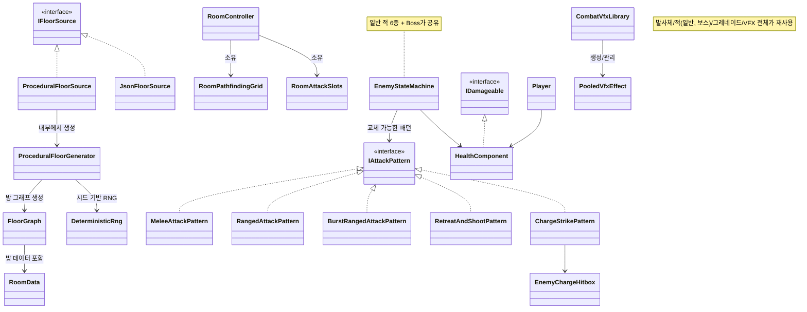

# RogueLike — 상세 기술서

## 1. 프로젝트 개요

- **개발 기간**: 2026.08.19 ~ 진행 중
- **프로젝트**: RogueLike — 3D 쿼터뷰 액션 로그라이트(바인딩 오브 아이작 /
  엔터 더 건전 계열), 개인 포트폴리오 프로젝트
- **참여 형태**: 1인 개발 — 기획, 시스템 설계, 클라이언트 프로그래밍, 데이터
  파이프라인 구축, 자동화 테스트, 성능 프로파일링을 단독으로 수행
- **개발 환경 & 사용 언어**: Unity 6000.3.22f1, C#, Universal Render Pipeline
  17.3.0, GitHub Actions(GameCI), Claude Code + Unity MCP
- **개발 방식**: Claude Code + Unity MCP를 활용한 AI 협업 개발 — 코드 작성뿐
  아니라 Unity 에디터 조작, 테스트, 프로파일링까지 AI와 함께 진행하였으며,
  구체적인 운영 방식은 3장에서 설명합니다.

## 2. 담당 업무

- 시드 기반 절차적 던전 생성 시스템 설계 및 구현
- 그리드 기반 A* 경로탐색 및 적 포메이션 AI 구현
- 일반 적/보스 공유 FSM 및 공격 패턴 시스템 구현
- 데이터 기반(JSON) 밸런스 및 던전 규칙 파이프라인 구축
- 오브젝트/VFX 풀링 시스템 구현
- Unity Profiler 기반 성능 측정 및 최적화
- EditMode/PlayMode 자동화 테스트 및 GitHub Actions CI 구축
- Claude Code + Unity MCP 기반 개발 워크플로우 설계 및 운영

## 3. Claude Code + Unity MCP 기반 개발 워크플로우

- 코드 작성, Unity 에디터 조작, 콘솔 로그 확인, Play Mode 실행, Profiler
  수치 조회까지 Claude Code와 Unity MCP를 통해 진행하였습니다. 장단점이 
  있고 고민이 필요한 사안에 대해서는 AI가 대안을 비교해 제시하도록 하고, 제시된 안들을
  검토한 뒤 적용 여부를 판단하는 방식으로 운영하였습니다.
- 세션이 종료되거나 대화가 길어질 경우 이전 판단 근거나 히스토리를 다시 확인하기
  어려워지는 문제가 있어, `Docs/` 하위에 성격이 다른 기록 문서(작업 일지,
  설계 결정 로그, 구조 스냅샷)를 역할별로 구분해 운영하였습니다. 이를 통해
  이후 세션에서도 이전 결정의 근거를 코드 전체를 재확인하지 않고 기록으로
  확인할 수 있었습니다.
- 아래 4장의 각 항목에는 이 워크플로우로 진행하는 과정에서 있었던 구체적인
  설계 판단과 디버깅 사례를 함께 기재하였습니다.

## 4. 상세 설명

아래는 각 시스템의 핵심 클래스와 관계를 정리한 구조도입니다.

### 4.1 시드 기반 절차적 던전 생성

- 자체 제작한 결정적 RNG(Deterministic RNG)를 기반으로 아이작(The Binding of
  Isaac) 스타일의 큐 성장 방식으로 방 그래프를 생성하는 로직을 구현하였습니다.
  동일한 시드에서는 항상 동일한 던전이 생성되도록 하였고, 층별 난이도 규칙과
  그래프 검증(연결성, 끊어진 연결 확인)을 함께 처리하여 도달 불가능한 방이
  발생하지 않도록 하였습니다.
- 절차 생성 결과와 개발자가 직접 작성한 JSON 데이터 참조 결과 중 하나를
  선택해 사용할 수 있도록 `IFloorSource` 인터페이스로 추상화하였으며, 층
  데이터가 손상된 경우 내장 비상용 층 데이터로 자동 대체되도록 구현하였습니다.
  - 방 내부 장애물 배치 시점을 결정할 때, 절차 생성 단계에서 전용 RNG
    스트림으로 미리 배치하는 방식과 각 방 초기화 시점에 즉석으로 배치하는
    방식을 비교 검토하였습니다. 후자는 "동일 시드는 항상 동일 결과"라는
    원칙상 RNG 스트림이 분리되는 문제와, 이후 적용 예정이던 A* 경로탐색이
    장애물 정보를 별도로 다시 조회해야 하는 중복 문제가 있어, 절차 생성
    단계에서 좌표 데이터를 미리 저장해두는 방식을 채택하였습니다. 이후 A*
    구현 시 해당 데이터를 입력값으로 그대로 재사용하여 작업 비용을
    절감하였습니다.

### 4.2 그리드 기반 A* 경로탐색 및 적 포메이션 AI

- Unity NavMesh 대신 방/장애물 생성기가 만든 런타임 그리드를 그대로
  재사용하는 자체 A* 경로탐색을 구현하였습니다. 시야가 장애물에 막힌
  경우에만 경로탐색으로 전환하고, 시야가 확보되면 직선 추격으로 복귀하도록
  하여 불필요한 연산을 최소화하였습니다.
- 여러 적이 한 대상에게 몰릴 때 서로 밀치며 겹치지 않도록, 근접/원거리
  역할별 링에 자리를 균등하게 배분하는 포메이션 로직(`RoomAttackSlots`)을
  구현하였습니다.
  - 100~200마리 규모 벤치마크 진행 중 이전 측정치 대비 성능이 저하되는
    구간을 확인하였습니다. 원인을 분석한 결과, 각 적 개체의 링 내 목표
    위치를 계산하는 `GetSlotPosition`이 매 물리 틱마다 `List.IndexOf`로
    순번을 조회하고 있었고, 동일 타입 200마리가 한 링에 밀집될 경우 틱당 약
    4만 회의 비교 연산이 발생하는 구조(O(N²))였습니다. 각 개체의 순번을
    `Dictionary`에 캐싱하여 조회를 O(1)로 변경하고, 비용이 큰 재배치 연산도
    개체가 링을 벗어나는 시점에 1회만 수행하도록 수정하여 해결하였습니다.
- 실제 플레이 테스트 중 대쉬로 위치가 급격히 이동할 때 적이 벽을 통과하는
  현상을 확인하였습니다. 원인은 적의 시야 판정이 실제 콜라이더를 기준으로
  검사하는 반면 이동 클램프는 항상 타일 전체 크기의 박스를 기준으로 동작하여
  두 판정 기준이 달랐기 때문이었고, 이동 클램프가 실제 콜라이더 바운즈를
  참조하도록 통일해 근본적으로 해결하였습니다.

### 4.3 적/보스 공유 FSM 및 전투 시스템

- 하나의 상태머신(Idle/Patrol/Chase/Attack/Stunned/Dead)을 일반 적 6종과
  보스가 함께 사용하도록 설계하였고, 교체 가능한 공격 패턴 컴포넌트로
  개체별 차이를 구현하였습니다. 일반 적은 근접, 원거리 견제, 연속 발사,
  집요한 추적 등 서로 다른 패턴을 조합해 다양한 위협 형태를 구성하였습니다.
- 보스의 돌진 공격은 단발 거리 판정이 아닌 돌진 내내 유지되는 히트박스로
  재설계하였고, 돌진 직전 일정 시간(기본 0.3초) 동안 방향을 유지하며 예고
  이펙트를 재생하는 텔레그래프를 구현하여 플레이어가 반응할 시간을
  확보하도록 하였습니다. 공격별로 다른 넉백 세기를 인터페이스 변경 없이
  적용할 수 있도록 구조화하였습니다.

### 4.4 데이터 기반 밸런스 및 던전 규칙

- 플레이어 스탯, 아이템 효과, 절차 생성 난이도 규칙을 모두 JSON 파일에서
  로드하도록 구현하였습니다. Unity 에디터를 열지 않고 텍스트 편집만으로
  수치 조정이 가능하도록 하였고, 파일이 없거나 파싱에 실패하는 경우 내장
  기본값으로 자동 대체되도록 예외 처리하였습니다.

### 4.5 오브젝트 및 VFX 풀링

- 범용 오브젝트 풀 하나를 발사체, 적, 보스, 그레네이드, 전투 VFX 전반에
  재사용하도록 구현하였습니다. VFX는 정적 싱글톤이 피격 등 기존 이벤트를
  구독해 트리거되는 구조로 설계하여, 각 공격/무기 코드가 이펙트 호출을 직접
  알 필요가 없도록 결합도를 낮추었습니다.

### 4.6 Unity Profiler 기반 성능 측정 및 최적화

- 별도 제작한 벤치마크 씬에서 적 50/100/200마리를 동시에 스폰해 Unity
  Profiler로 CPU 시간과 GC 할당량을 측정하였습니다. 최악의 경우(연속 발사
  패턴을 가진 개체 200마리)가 60FPS 예산의 44%를 사용하였고, VFX 풀링 적용
  이후 4종 전체가 예산의 50% 이하를 유지하는 것을 확인하였습니다. 일부
  구간에서 평소 처리 시간이 소폭 증가하는 현상이 있었으나, 이는 포메이션
  링이 수용 가능한 인원(근접 약 7마리, 원거리 약 34마리)을 초과하는
  인위적 테스트 조건에서 발생한 것으로 확인하였고, 프레임 초과 빈도
  기준으로는 전 구간에서 개선(최대 7.5% → 1.5% 이하)된 것을 확인하였습니다.
  - 성능 실측 과정에서 Unity MCP로 Play Mode 진입, 스폰, Profiler 값 수집을
    자동화하였을 때 스폰 개체 수와 무관하게 CPU 시간이 동일하게 측정되는
    현상을 확인하였습니다. 원인은 MCP 통신 자체의 오버헤드가 매 프레임
    반영되어 측정 신호를 가리고 있었기 때문이었고, 측정 구간 동안에는
    명령을 전송하지 않고 Stop 이후에도 유지되는 Profiler 프레임 히스토리
    버퍼를 사후에 조회하는 방식으로 측정 절차를 변경해 유효한 수치를
    확보하였습니다.

### 4.7 자동화 테스트 및 CI

- EditMode/PlayMode 테스트를 GitHub Actions(GameCI)와 연동해 매 push마다
  자동 실행되도록 구축하였습니다. 절차 생성, 경로탐색, 포메이션과 같이 씬
  없이도 검증 가능한 로직은 순수 C# 클래스로 분리해 EditMode에서 빠르게
  회귀 여부를 확인할 수 있도록 하였습니다.
