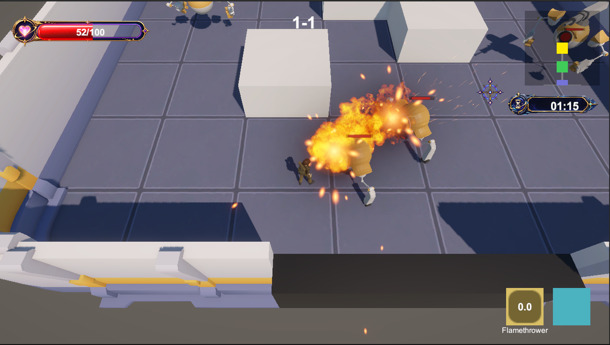
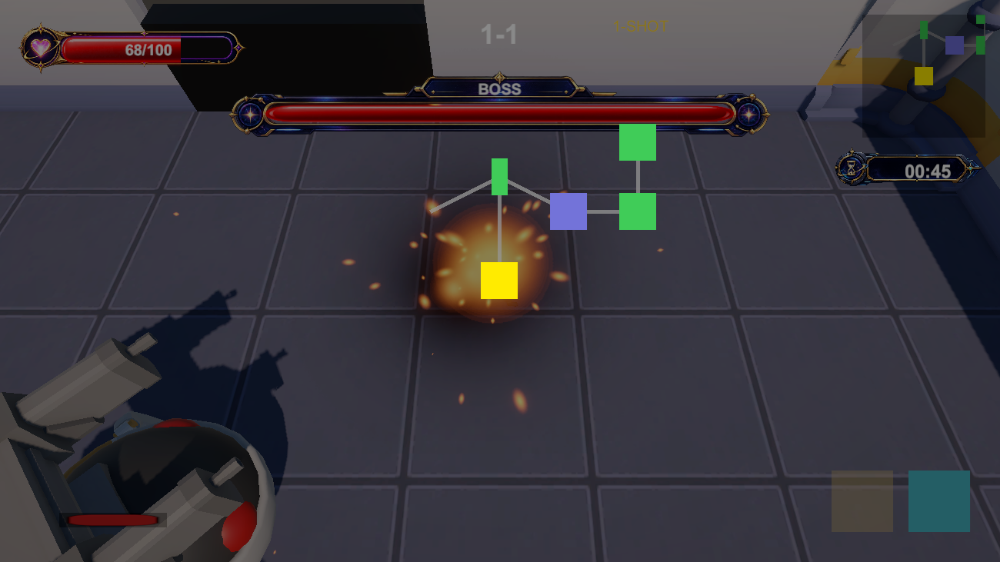
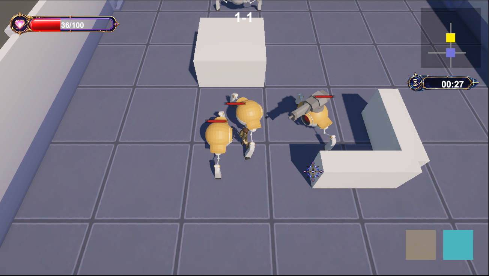
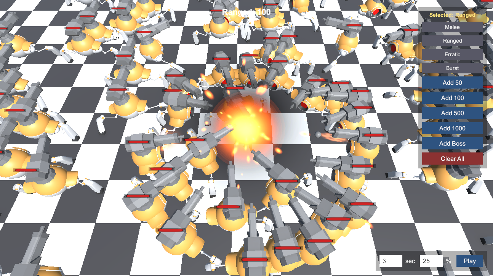
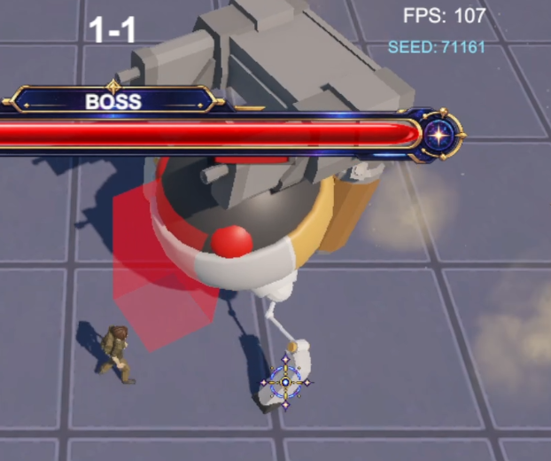

<div align="center">

# RogueLike

**시드로 절차 생성되는 던전을 문으로 이어진 방마다 돌파하는 3D 쿼터뷰 액션 로그라이트**


[](https://github.com/highfive37/RogueLike/actions/workflows/ci.yml)

게임 클라이언트 개발 포트폴리오 · 개발자 서영훈



[프로젝트 소개](#프로젝트-소개) · [핵심 플레이](#핵심-플레이) · [구현 포인트](#구현-포인트) · [코드 탐색](#코드-탐색) · [개발 현황](#개발-현황)

</div>

---

## 프로젝트 소개

RogueLike는 시드마다 다른 모양으로 이어지는 던전을 방 단위로 돌파하는 3D 쿼터뷰
로그라이크입니다. 특정 공격(근거리/원거리) 방식의 캐릭터를 선택 후 각각의 요소가 있는 방에 들어가 적을 전부 처치하거나 아이템을 획득하여 다음 방으로 넘어갈
수 있고, 방마다 달라지는 지형·장애물과 대형을 갖춘 적들을 상대하며 층 끝의 보스까지 도달하여 마지막 층의 끝까지 도달하는 것이 게임의 목표입니다.

**절차적으로 생성되지만 항상 풀 수 있는 던전, 그리고 그 던전 위에서 자연스럽게
움직이는 적 AI**를 만드는 것을 목표로 개발하고 있습니다. 게임 자체의 완성도보다,
이 목표를 이루기 위해 어떤 기술적 선택을 했고 왜 그렇게 했는지를 설명할 수 있는
프로젝트로 만드는 데 초점을 맞췄습니다.

| 항목 | 내용 |
| :--- | :--- |
| 장르 | 3D 쿼터뷰 액션 로그라이트 (바인딩 오브 아이작 / 엔터 더 건전 계열) |
| 플랫폼 | PC (포트폴리오 프로젝트) |
| 개발 환경 | Unity 6000.3.22f1 · C# · Universal Render Pipeline 17.3.0 |
| 현재 단계 | 타이틀 → 캐릭터 선택 → 시드 기반 3층 런 → 보스 → 클리어/게임오버까지 처음부터 끝까지 플레이 가능한 개발 데모 |
| 담당 작업 | 1인 개발 — 시스템 설계, 절차적 생성/AI/전투 구현, 데이터 파이프라인, 자동화 테스트, 프로파일링, Claude Code + Unity MCP 기반 AI 협업 워크플로우 설계 |

> **저장소 범위** — 이 저장소는 코드만이 아니라 씬·프리팹·밸런스 데이터를 포함한
> Unity 프로젝트 전체입니다. Unity 6000.3.22f1로 클론해 열면 `Title` 씬부터 바로
> 실행할 수 있습니다.

## 핵심 플레이 루틴

```text
캐릭터 선택 (근접 / 원거리)
        ↓
1층  방 입장 → 전투 → 클리어 → 다음 방 → … → 보스 처치
        ↓
2층  방 입장 → 전투 → 클리어 → 다음 방 → … → 보스 처치
        ↓
3층  방 입장 → 전투 → 클리어 → 다음 방 → … → 보스 처치
        ↓
     게임 클리어

(전투/보스 중 사망 시 → 게임오버)
```

### 01. 시드마다 다른 형태의 던전 생성

같은 시드는 항상 같은 던전을 만들고, 다른 시드는 매번 다른 방 배치·형태·장애물을
만듭니다. 아이작 스타일로 중앙에서 시작해 큐를 성장시키는 방식으로 방 그래프를 만든
뒤, 연결성을 검증해 갈 수 없는 방이 생기지 않도록 보장합니다.

| 절차 생성 던전 (미니맵) | 전투방 내부 |
| :---: | :---: |
|  |  |

### 02. 뭉치지 않고 대형을 갖추는 적, 장애물을 우회하는 추격

여러 적이 한 플레이어에게 몰릴 때 서로 밀치며 뭉개지지 않도록 근접/원거리 링에
균등하게 자리를 배분하고, 시야가 장애물에 막히면 그리드 기반 경로탐색으로 우회해
따라옵니다.



*여러 적이 원형으로 자리를 나눠 서고, 시야가 막힌 적은 장애물을 돌아서 추격합니다.*

### 03. 준비 동작이 있는 보스의 돌진 공격 패턴

보스의 돌진 공격은 예고 없이 순간적으로 맞는 판정이 아니라, 돌진 내내 유지되는
히트박스로 판정하고 전용 넉백을 적용해 보스가 전진할 때, 플레이어가 치여서 데미지를 입는 느낌을 주도록 설계했습니다. 
돌진 직전에는 보스가 방향을 잡고 멈춰 선 채 머리 위치에 돌진 예고 이펙트를 잠깐 재생해 실제로 피할 시간을 주고, 
돌진은 쿨다운마다 항상 나오는 게 아니라 확률적으로 섞여 나오는 패턴 중 하나로 다뤄 근접 공격과 번갈아 나오도록 했습니다.

| 보스 돌진 판정/넉백 |
| :---: |
|  |

## 구현 포인트

### 시드 기반 절차적 던전 생성

자체 제작한 결정적 RNG가 아이작 스타일의 큐 성장 방식으로 방 그래프를 생성하고,
층별 난이도 규칙과 그래프 검증(연결성, 끊어진 연결 확인)을 함께 처리합니다. 
절차 생성과 개발자가 직접 작성한 각 층의 JSON 데이터를 참조하는 방식 중 하나를 고를 수 있도록 `IFloorSource` 뒤에
추상화해뒀고, 층 데이터가 손상되면 내장 비상용 층으로 자동 대체됩니다.

- **살펴볼 부분:** 큐 성장 알고리즘, 시드 재현성, 그래프 연결성 검증과 폴백
- **관련 코드:** [ProceduralFloorGenerator.cs](https://github.com/highfive37/RogueLike/blob/main/Assets/Scripts/Stage/ProceduralFloorGenerator.cs) · [DeterministicRng.cs](https://github.com/highfive37/RogueLike/blob/main/Assets/Scripts/Core/DeterministicRng.cs) · [FloorGraph.cs](https://github.com/highfive37/RogueLike/blob/main/Assets/Scripts/Stage/FloorGraph.cs) · [IFloorSource.cs](https://github.com/highfive37/RogueLike/blob/main/Assets/Scripts/Stage/IFloorSource.cs)

### 그리드 기반 A* 경로탐색과 적 포메이션

방/장애물 생성기가 이미 만들어둔 런타임 그리드를 그대로
재사용하는 자체 A*를 적용했습니다. 시야가 막혔을 때만 경로탐색으로 전환하고
확보되면 직선 추격으로 복귀하며, 여러 적이 한 대상에게 몰릴 때는 근접/원거리 링에
매 프레임 균등하게 슬롯을 재분배해 뭉침을 방지합니다. 아직 미완성된 부분이라 특정 장애물이 있는 방에서는 경로 탐색 동작이 잘 되지 않아 확인 중에 있습니다.

- **살펴볼 부분:** 시야 차단 시에만 경로탐색으로 전환하는 조건, 슬롯 예약/해제(적이 링에 들어오고 빠질 때 자리를 배정·반납하는 처리)
  생명주기
- **관련 코드:** [RoomPathfindingGrid.cs](https://github.com/highfive37/RogueLike/blob/main/Assets/Scripts/Room/RoomPathfindingGrid.cs) · [RoomAttackSlots.cs](https://github.com/highfive37/RogueLike/blob/main/Assets/Scripts/Room/RoomAttackSlots.cs) · [RoomController.cs](https://github.com/highfive37/RogueLike/blob/main/Assets/Scripts/Room/RoomController.cs)

### 일반 적과 보스가 공유하는 FSM

하나의 상태머신(Idle/Patrol/Chase/Attack/Stunned/Dead)을 일반 적 6종과 보스가
함께 쓰고, 교체 가능한 공격 패턴으로 개체별 차이를 만들었습니다. 
일반 적은 같은 상태머신 위에 패턴만 바꿔 끼워 근접으로 밀어붙이는 개체, 거리를
벌리며 쏘는 개체, 한 번에 발사체를 3발 쏘는 개체, 한번 발견하면 방을 벗어날 때까지
집요하게 쫓아오는 개체처럼 서로 다른 개체들을 만들어냈고,
보스의 공격 패턴은 특별히 돌진 공격으로 돌진 내내 보스 캐릭터 앞에 유지되는 히트박스로 설계했고, 
공격별로 다른 넉백 세기를 인터페이스 변경 없이 적용할 수 있게 만들었습니다.

- **살펴볼 부분:** 상태 전환 조건, 돌진 히트박스의 활성/해제 시점
- **관련 코드:** [EnemyStateMachine.cs](https://github.com/highfive37/RogueLike/blob/main/Assets/Scripts/Enemy/EnemyStateMachine.cs) · [ChargeStrikePattern.cs](https://github.com/highfive37/RogueLike/blob/main/Assets/Scripts/Enemy/ChargeStrikePattern.cs)

### 데이터 기반 밸런스와 던전 규칙

플레이어 스탯, 아이템 효과, 절차 생성 난이도 규칙이 전부 JSON에서 로드됩니다.
JSON만으로 수치를 조정할 수 있고, 파일이 없거나 파싱에
실패하면 내장 기본값으로 대체됩니다.

- **관련 코드:** [GameBalance.cs](https://github.com/highfive37/RogueLike/blob/main/Assets/Scripts/Balance/GameBalance.cs) · [GameFloors.cs](https://github.com/highfive37/RogueLike/blob/main/Assets/Scripts/Stage/GameFloors.cs)

### 오브젝트 & VFX 풀링

게임 볼륨이 작아 현재는 범용 오브젝트 풀 하나를 발사체·적·보스·그레네이드·전투 VFX 전부에 재사용하고 있는 구조입니다.
VFX는 정적 싱글톤이 피격 등 기존 이벤트를 구독해 트리거하는 방식이라, 각 공격/무기
코드가 이펙트 호출을 직접 알 필요가 없습니다.

- **관련 코드:** [GameObjectPool.cs](https://github.com/highfive37/RogueLike/blob/main/Assets/Scripts/Pooling/GameObjectPool.cs) · [CombatVfxLibrary.cs](https://github.com/highfive37/RogueLike/blob/main/Assets/Scripts/Combat/CombatVfxLibrary.cs)

### 벤치마크로 실측한 성능

따로 제작된 벤치마크 씬에서 적 50/100/200마리를 동시에 스폰하고 Unity Profiler로
CPU 시간과 GC 할당량을 측정했습니다. 최악의 경우(3발 연속 발사 패턴을 가진
BurstRanged 200마리)가 60FPS 예산의 44%, VFX 추가/풀링 적용 후에는 적 4종 전부 50%
이하를 유지했습니다. 다만 한 타입만 100~200마리씩 몰아넣은 일부 구간에서는 프레임이 오히려 소폭 나빠졌는데, 
프로파일러로 확인해보니 이건 실제 전투에서는 잘 생기지 않는 조건인 '슬롯 링이 감당할 수 있는 인원(근접 ~7마리, 원거리 ~34마리)을 훨씬 넘겨 몰아넣은 것'으로 인해 평소보다 수치가 나쁘게 나온 거였습니다.
반대로 프레임이 순간적으로 튀는 빈도는 전 구간, 전 타입에서 뚜렷이 줄어서(최대 7.5%였던 게 전부 1.5% 이하로), 
평소 수치 하나만 보고 성능을 판단하지 않고 이렇게 튀는 빈도까지 같이 봐야 한다는 걸 이번 실측으로 확인했습니다.

- **관련 코드:** [BenchmarkSpawner.cs](https://github.com/highfive37/RogueLike/blob/main/Assets/Scripts/Benchmark/BenchmarkSpawner.cs)

### 자동화 테스트 + CI

EditMode/PlayMode 테스트 스위트가 GitHub Actions(GameCI)를 통해 매 push마다
자동 실행됩니다. 절차 생성, 경로탐색, 포메이션처럼 씬 없이도 검증 가능한 로직은
전부 순수 C# 클래스로 분리해 EditMode에서 기존 기능이 깨졌는지 빠르게 확인합니다.

- **관련 코드:** [.github/workflows/ci.yml](https://github.com/highfive37/RogueLike/blob/main/.github/workflows/ci.yml) · [Assets/Tests/](https://github.com/highfive37/RogueLike/tree/main/Assets/Tests)

### Claude Code + Unity MCP 기반 AI 협업 워크플로우

코드 작성뿐 아니라 Unity 에디터 조작, 테스트, 프로파일링까지 Claude Code와 Unity MCP를 활용해 진행했습니다. 단순히 구현을 맡기는 방식보다는 문제가 생겼을 때 원인을 같이 추적하고, 여러 해결 방법을 비교한 뒤 적용할 방법을 정하는 식으로 사용했습니다.
예를 들어 대쉬 후 적이 장애물을 뚫고 따라오는 문제가 있었는데, 분석 과정에서 시야 판정은 실제 Collider 크기를 보고 있는 반면 이동 클램프는 별도로 계산된 장애물 크기를 사용하고 있다는 차이를 발견했습니다. 임시로 이동을 제한하는 방법도 검토했지만, 두 판정이 같은 장애물 정보를 사용하도록 통일하는 쪽을 선택했습니다. 벤치마크 과정에서도 적 포메이션의 슬롯 조회가 물리 틱마다 리스트를 순회하면서 적 수가 많아질수록 비용이 커지는 것을 프로파일링으로 확인했고, 순번을 캐싱해 조회를 O(1)로 변경했습니다.
AI와의 대화는 세션이 바뀌면 이전 판단 과정이 바로 보이지 않는 문제가 있어, Docs/ 아래에 용도별 기록 문서를 두는 방식으로 보완했습니다. 그날 구현한 내용과 실제 검증 결과는 DevLog.md, 여러 대안을 비교한 설계 결정은 AI_Decision_Log.md, 구조가 크게 바뀐 뒤의 현재 프로젝트 상태는 ClaudeSessionSummary.md에 정리했습니다. 덕분에 다음 세션에서도 이전 결정의 이유를 다시 코드를 전부 추적하지 않고 확인할 수 있도록 작업 흐름을 유지했습니다.

## 코드 탐색

처음 살펴볼 때는 **던전 생성 → 방/적 AI → 전투·아이템 → UI** 순서를 권장합니다.

| 경로 | 주요 내용 |
| :--- | :--- |
| [Stage/](https://github.com/highfive37/RogueLike/tree/main/Assets/Scripts/Stage) | 절차적 던전 생성, 층 데이터 소스(절차/JSON), 그래프 검증 |
| [Room/](https://github.com/highfive37/RogueLike/tree/main/Assets/Scripts/Room) | 방/문 그래프, 지오메트리, 장애물, 경로탐색, 적 포메이션 |
| [Enemy/](https://github.com/highfive37/RogueLike/tree/main/Assets/Scripts/Enemy) | FSM, 공격 패턴, 애니메이션 연동 |
| [Combat/](https://github.com/highfive37/RogueLike/tree/main/Assets/Scripts/Combat) | 데미지, 무기, 액티브/패시브 아이템, VFX |
| [Player/](https://github.com/highfive37/RogueLike/tree/main/Assets/Scripts/Player) | 이동, 조준, 대시, 피격 반응 |
| [Pooling/](https://github.com/highfive37/RogueLike/tree/main/Assets/Scripts/Pooling) | 범용 오브젝트 풀 |
| [Benchmark/](https://github.com/highfive37/RogueLike/tree/main/Assets/Scripts/Benchmark) | 격리 성능 측정 |
| [Editor/](https://github.com/highfive37/RogueLike/tree/main/Assets/Editor) | SO 데이터 검증 + 던전 그래프 비주얼라이저 |
| [Tests/](https://github.com/highfive37/RogueLike/tree/main/Assets/Tests) | EditMode/PlayMode 자동화 테스트 |

*코드 탐색 링크는 `main` 브랜치 기준입니다.*

## 더 자세히 보기

이 README보다 더 자세한 설계 판단 근거, 디버깅 사례, 클래스 구조도는
[PortfolioDetail.md](Docs/PortfolioDetail.md)에 정리해뒀습니다.

## 개발 현황

**데모에서 구현한 핵심 흐름**

- 시드 기반 절차적 던전 생성 (형태 다양화 + 멀티셀 병합 + 패턴 기반 장애물 배치)
- 그리드 A* 경로탐색 + 적 포메이션(방 공격 슬롯)
- 일반 적 6종 + 보스 FSM, 보스 돌진 특수 공격 패턴
- 액티브/패시브 아이템, 바닥 드롭 + 아이템 방/보스방 보장 지급
- 오브젝트 & VFX 풀링, 벤치마크로 Before/After 프로파일링 측정
- 자동화 테스트(EditMode/PlayMode) + GitHub Actions CI 셋팅
- SO 데이터 검증 툴 + 던전 그래프 비주얼라이저(에디터 확장)
- 타이틀 → 캐릭터 선택 → 3층 런 → 보스 → 클리어/게임오버 전체 루프

**다음 개발 목표**

- 세이브/로드(런 이어하기)
- 리소스 교체 - 발사체, 드랍 아이템, 캐릭터 스탯 및 아이템 슬롯
- 적 추적 기능 보완 작업 - 현재는 특정 장애물에서 길을 찾지 못하는 이슈가 있음
---

<div align="center">

**서영훈 · Game Client Programmer**
[GitHub](https://github.com/highfive37)

</div>
